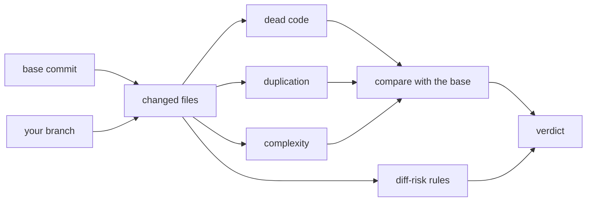

A full report of an old project has hundreds of findings, and a pull request cannot fix them all. When CI fails on each of them, it fails on each pull request. The one finding that a change adds is then lost in the list. `fallow audit` runs a [changed-code check](/concepts/changed-code): it reports only the findings in the code that your change touches, and gives one verdict for the change.

```bash
npx fallow audit
```

## What fallow finds

A branch of the demo project has two commits. The first adds `src/services/cart-report.ts`, with a copy of the cart summary and an export `cartTotalCents` that no file imports. The second adds a complex `discountFor` function to the same file, and a comment above `classifyCustomer` in `src/services/customers.ts`. The audit of the branch:

```text
Audit scope: 3 changed files vs main (local main) (a5ee3ae..HEAD)

── Dead Code ──────────────────────────────────────

● Unused exports (1)
  src/services/cart-report.ts
    :25 cartTotalCents

── Duplication ────────────────────────────────────

● Duplicates (1 clone groups)

     17 lines  3 instances  spread 2  dup:f42424e8
    src/reports/export.ts:3-19
    src/services/cart-report.ts:7-23
    src/utils/summary.ts:7-23

── Complexity ─────────────────────────────────────

■ Metrics: 122 LOC · dead files 0.0% · dead exports 16.7% · avg cyclomatic 5.3 · p90 cyclomatic 23 · maintainability 84.1 (moderate) · 1 unused dep

● High complexity functions (2)
  src/services/customers.ts
    :10 classifyCustomer CRITICAL
          23 ! cyclomatic   32 ! cognitive   39 lines
         552.0 ! CRAP
  src/services/cart-report.ts
    :27 discountFor CRITICAL
          12   cyclomatic   30 ! cognitive   22 lines
         156.0 ! CRAP

✗ dead code: 1 issue · complexity: 2 findings · duplication: 1 clone group · 3 changed files (0.45s)
  audit gate excluded 1 inherited finding (run with --gate all to enforce)
```

| Part | Meaning |
|:--|:--|
| `Audit scope` | The number of changed files, and the base: the branch that fallow compares with. |
| Sections | One section for each analysis that found something in the changed files. Here: dead code ([unused export](/rules/unused-export)), duplication ([clone group](/rules/code-duplication)) and complexity ([high complexity](/rules/high-complexity)). |
| `■ Metrics` | The [health](/analysis/health) metrics of the changed files. |
| `✗` | The verdict line. `✗` is `fail`, `⚠` is `warn`, `✓` is `pass`. |
| `excluded 1 inherited finding` | A finding that the base branch already has. It is in the report, and it does not count for the verdict. |

The run exits with code 1. The new export `cartTotalCents` and the new function `discountFor` fail the check. `classifyCustomer` is in a changed file, but it was complex before the branch, so it does not count.

## How fallow decides

### What audit runs

Audit takes the files that the change touches, runs three analyses on them, and compares each result with the base. The diff-risk rules read the change itself. Each path ends in the verdict:



The [dead code](/analysis/dead-code) part includes each dependency finding of a changed `package.json`. The [duplication](/analysis/duplication) part includes each clone group with an instance in a changed file, so the old copies in `export.ts` and `summary.ts` show above. The [complexity](/analysis/health) part uses the same limits as `fallow health`. Audit does not run the hotspot and score parts of health, [security](/analysis/security), [feature flags](/analysis/feature-flags) or [mutation testing](/analysis/mutation).

### New and inherited findings

By default, audit also analyzes the base: the commit where your branch started. It compares the two results. A finding that the base also has is **inherited**. A finding that only your change has is **introduced**. Fallow matches findings by file, rule and name, and not by line, so a line that moves does not make an old finding new. That is why `classifyCustomer` stays inherited, although the new comment moved it from line 9 to line 10. A complex function that the change makes more complex is `worsened`: it makes the verdict at least `warn`.

The `--gate` option chooses which findings count for the verdict:

| Value | Counts | Use it when |
|:--|:--|:--|
| `new-only` (default) | The findings that the change introduces. | You adopt fallow in an existing project. |
| `all` | Each finding in the changed files. | The project has no findings, and each touched file must stay clean. |

With `--gate all`, the example above also counts `classifyCustomer`. Set the value for each run in your config file with `audit.gate`.

### The verdict

The [verdict](/concepts/changed-code) is `pass`, `warn` or `fail`. The severity of the rule of each counted finding decides it:

- A finding with the severity `error` makes the verdict `fail`, and the exit code 1.
- A finding with the severity `warn` makes the verdict at least `warn`. The exit code stays 0.
- No counted finding gives `pass`.

In the example, unused exports and complexity findings default to `error`. A new clone group defaults to `warn`.

### Diff-risk rules

Some risks are in the change itself, for example a test that the change skips, or a new suppression comment. The code after the change does not show them. The diff-risk rules compare the old text and the new text of each changed file. A staged change that adds a suppression comment above `cartTotalCents` gives:

```text
── Diff risk ──────────────────────────────────────
  src/services/cart-report.ts:25  added-suppression [warn]  fallow-ignore
```

The rules are [`weakened-tests`](/rules/weakened-tests), [`added-suppression`](/rules/added-suppression), [`test-only-branch`](/rules/test-only-branch), [`diverged-clone-sibling`](/rules/diverged-clone-sibling) and [`added-dependency`](/rules/added-dependency). [Diff-risk rules](/cli/audit#diff-risk-rules) has the default of each rule.

## Act on a finding

Fix the introduced findings first. They are in the code that you changed, so you know it best:

- An unused export such as `cartTotalCents`: remove it, or remove the `export` keyword.
- A new clone group: call the code that exists. Here, `reportCart` can call `summarizeCart`. See [Duplication](/analysis/duplication).
- A complex function such as `discountFor`: split it before the merge. See [Health](/analysis/health#act-on-a-finding).

An inherited finding in a file that you touch is optional work. Fix it when the change is small. Otherwise leave it for a separate cleanup.

## Fail a run

The rules in your config file decide `fail` or `warn` for each issue type. For example, to keep new clone groups from failing a change, and to make new unused exports only a warning:

```jsonc
// .fallowrc.jsonc
{
  "rules": {
    "introduced-clone-group": "warn",
    "unused-exports": "warn"
  }
}
```

The complexity rules `complexity-cyclomatic`, `complexity-cognitive` and `complexity-crap` work in the same way. The limits for complexity come from the `health` config. See [Rules](/configuration/rules). Audit ignores `--fail-on-issues` and keeps its own verdict. Where the verdict stops a change depends on where you run audit.

### Before a commit

`fallow audit --staged` checks the staged changes against `HEAD`. It reads each file from the index, so unstaged edits do not change the verdict. `fallow init --hooks` writes a git pre-commit hook that runs this command. See [`fallow hooks`](/cli/hooks).

### In CI

On a pull request, audit compares with the merge base of the target branch. Fetch the full git history, so that fallow finds the base. The GitHub Action and the GitLab template run audit on each pull request. See [Check each pull request](/start/first-ci) and [Run fallow in CI](/integrations/ci).

### With a coding agent

`fallow audit --format json` gives the `verdict` at the top, and each finding has `introduced` and an `actions` array with the next steps. A coding agent can read it and fix the introduced findings before it commits. See [Fallow for coding agents](/integrations/agents).

## What fallow cannot see

- A change without its base. Audit needs git and the base commit. A shallow clone often lacks the base: with `--base <ref>`, the run stops with exit code 2. Without a base that fallow can find, the audit checks no files and prints a note.
- An old finding in a file that the change does not touch. It is not in the report. Run `fallow` on the main branch for the full picture.
- Whether the change is correct. Audit compares structure only.

The `new-only` value analyzes the base too, so it takes longer than `--gate all`, which skips that step.

## Reference

- [`fallow audit`](/cli/audit): each option, the JSON output and the exit codes.
- [Changed code and baselines](/concepts/changed-code): the changed-code check, the verdict and baselines.
- [`audit` config](/reference/config-rules#audit): the gate and the other keys.
