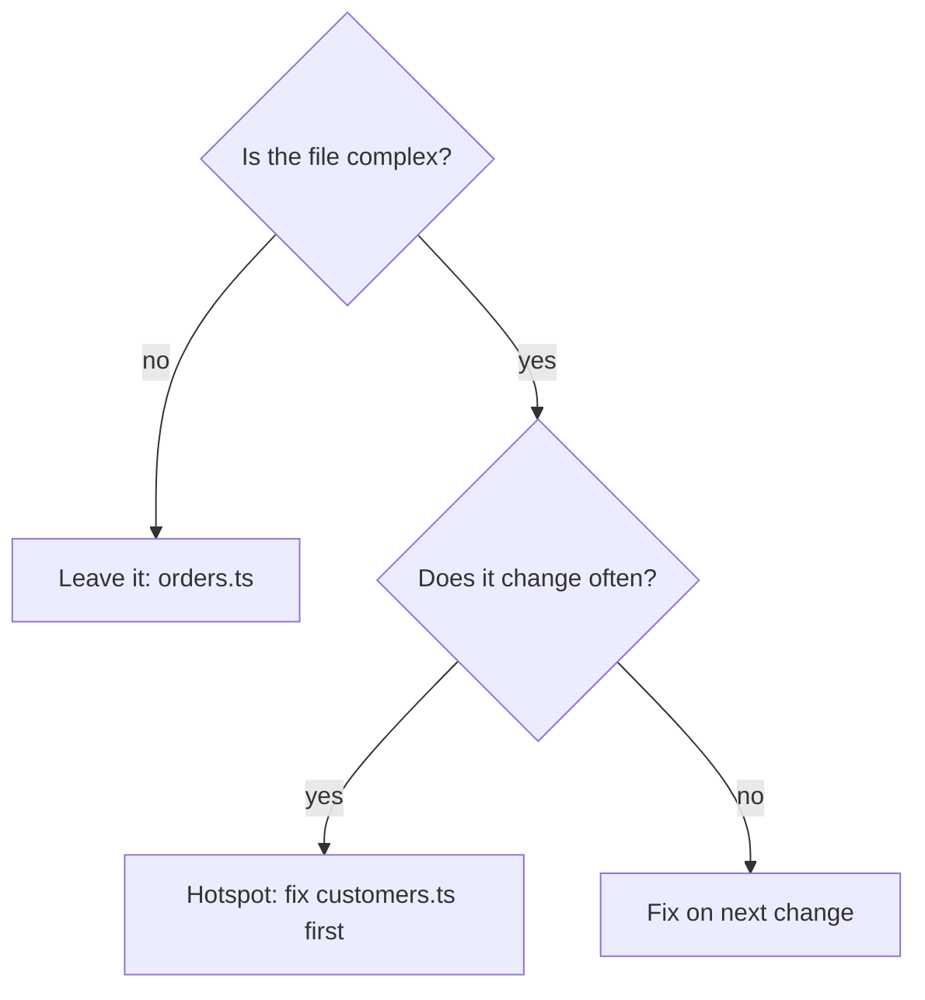

Some code is hard to change: a function with many branches, a file that each change touches, complex code that no test runs. `fallow health` finds these places and ranks them, so that you know what to fix first.

## What fallow finds

Run it on the demo project:

```bash
npx fallow health
```

```text
● Health score: 61 C
  Deductions: unused deps -25.0 · duplication -10.0 · dead exports -2.9 · dead files -1.3

■ Metrics: 214 LOC · dead files 6.3% · dead exports 14.3% · avg cyclomatic 2.1 · p90 cyclomatic 2 · maintainability 92.8 (good) · 0 churn hotspots (since 6 months) · 1 unused dep · duplication 20.0%

● High complexity functions (1)
  src/services/customers.ts
    :9 classifyCustomer CRITICAL
          23 ! cyclomatic   32 ! cognitive   39 lines
         552.0 ! CRAP

● File health scores (13 files) · sorted by triage concern

   86.2    src/services/customers.ts                       risk
             48 LOC    1 fan-in    0 fan-out    0% dead  0.48 density  552.0 risk

   78.8    src/utils/legacy-currency.ts                    structure
              4 LOC    0 fan-in    0 fan-out  100% dead  0.50 density  2.0 risk

● Refactoring targets (1)
  1 low effort
    score = quick-win ROI (higher = better) · pri = absolute priority

   17.4  pri:17.4    src/services/customers.ts
         complexity · effort:low · confidence:high  Extract classifyCustomer (cognitive: 32) in 48-LOC file into smaller functions
         importers: src/index.ts (classifyCustomer)

✗ 1 above threshold · 24 analyzed · maintainability 92.8 (good) (0.02s)
```

| Part | Meaning |
|:--|:--|
| `Health score: 61 C` | The [health score](#health-score) of the project and its grade. |
| `Deductions` | The areas that lowered the score, largest first. |
| `Metrics` | The totals of the project. Each value feeds the score. |
| `High complexity functions` | The functions above a limit ([cyclomatic](/rules/high-cyclomatic-complexity), [cognitive](/rules/high-cognitive-complexity) or [CRAP](/rules/high-crap-score)). `!` marks each value that is above its limit. `CRITICAL` is the severity of the finding: `moderate`, `high` or `critical`. |
| `File health scores` | The [maintainability index](#maintainability-index) of each file, and its worst CRAP score as `risk`. The tag `risk` or `structure` tells which of the two puts the file in its place in the list. |
| `Refactoring targets` | The files to fix first, with a recommendation for each file. |
| `✗ 1 above threshold` | The summary. `✗` means that the run failed: the exit code is 1. |

A score of 61 next to a maintainability of 92.8 looks wrong, but each number measures a different thing. [Why is the score 61?](#health-score) takes the score apart. The run also has a hotspot section, which is empty here because the demo project has only one commit.

## How fallow decides

The metrics build on each other. A complex function is hard to change. CRAP adds one fact: nothing tests that function. The maintainability index sums a whole file, and a hotspot adds one more fact: the file changes often. Fallow reads the branches of each function and your git history. It does not run your tests, so without a coverage file the test coverage is an estimate.

### Complexity of a function

**Cyclomatic complexity** is the number of paths through a function. Fallow starts at 1 and adds 1 for each `if`, `else if`, loop, `case`, `catch`, `?:`, `&&`, `||`, `??`, `?.`, `&&=`, `||=` and `??=`. The limit is `maxCyclomatic`, 20 by default.

**Cognitive complexity** is an estimate of how hard a function is to read. Each branch adds 1, and a branch inside another branch adds 1 for each level of nesting. An `else` and an `else if` add 1 and no nesting. A `switch` adds 1 as a whole, and its `case` labels add nothing. A sequence of the same logical operator, for example `a && b && c`, adds 1, and each change of the operator adds 1 more. The limit is `maxCognitive`, 15 by default.

The two values can disagree:

```ts
// cyclomatic 6, cognitive 1: many paths, easy to read
export function getStatusLabel(status: string): string {
  switch (status) {
    case "pending": return "Pending";
    case "active": return "Active";
    case "paused": return "Paused";
    case "cancelled": return "Cancelled";
    case "completed": return "Done";
    default: return "Unknown";
  }
}

// cyclomatic 4, cognitive 7: fewer paths, hard to read
export function processOrder(order: Order): string {
  if (order.items.length > 0) {          // +1
    if (order.customer.verified) {       // +2 (nested once)
      if (order.total > order.limit) {   // +3 (nested twice)
        return "requires_approval";
      }
    } else {                             // +1
      return "unverified";
    }
  }
  return "empty";
}
```

The `switch` needs more tests, because it has more paths. The nested `if` chain is harder to read and to change.

### CRAP

Complexity says how hard a function is. It does not say if a test protects it, and that is the fact that **CRAP** adds: it is a score that combines the complexity of a function with its test coverage. Fallow squares the cyclomatic complexity, multiplies it by the cube of the uncovered share, and adds the complexity again. A function that tests cover completely scores its cyclomatic complexity. A function that no test runs scores the square plus the complexity. The limit is `maxCrap`, 30 by default: an untested function with cyclomatic complexity 5 scores exactly 30.

Fallow gets the coverage in one of two ways:

| Coverage | When | How fallow gets it |
|:--|:--|:--|
| Estimated | By default | From the imports of your test files. A function that a test imports by name gets 85 percent. Another function in a file that tests reach gets 40 percent. A function in a file that no test reaches gets 0 percent. |
| Measured | With `--coverage <path>` | From the coverage file of your test runner: an Istanbul `coverage-final.json`, or a V8 coverage directory. |

In the demo, no test reaches `customers.ts`, so `classifyCustomer` gets 0 percent: 23 × 23 + 23 = 552. To get measured scores from Vitest, see [CRAP scores with Vitest](/guides/crap-with-vitest).

### Maintainability index {#maintainability-index}

CRAP rates one function. The **maintainability index** (MI) rates a whole file: it is a number from 0 to 100, and higher is better. Fallow starts at 100 and subtracts three penalties:

- the complexity density: the cyclomatic complexity of the file for each line of code,
- the share of the exports of the file that no file uses,
- the fan-out: the number of files that the file imports.

A file under 50 lines gets a smaller density penalty, because a short file stays easy to read. The fallow MI uses a different formula from the MI of other tools. Do not compare the two values.

### Hotspots {#hotspots}

A complex file costs you only when you change it, so hotspots add the change history. A **hotspot** is a file that is complex and that changes often. Fallow divides the change frequency of the file by the highest change frequency in the project, and does the same for the complexity density. The hotspot score is the product of the two shares, from 0 to 100. A file gets 100 only when it has both the most changes and the highest density. A recent commit counts more than an old commit: the weight of a commit halves each 90 days.

Hotspots need git history. Fallow reads the last 6 months and skips files with fewer than 3 commits. Change these values with `--since` and `--min-commits`. On a copy of the demo with a few commits, the section looks like this:

```text
● Hotspots (2 files, since 6 months)

  100.0 ─  src/services/customers.ts
           7 commits     53 churn  0.43 density   1 fan-in  ─ stable  2.0 files/commit

    9.5 ─  src/services/orders.ts
           4 commits     21 churn  0.09 density   3 fan-in  ─ stable  2.0 files/commit

  11 files excluded (< 3 commits)
```

The arrow and the last word show the trend: the file changes more often (`▲ accelerating`), at the same rate (`─ stable`), or less often (`▼ cooling`).

Ask two questions of each file to decide where to start. `customers.ts` is dense and changes most, so it comes first. `orders.ts` changes too, but its code is simple. Fix a complex file that changes rarely when you next change it.



### Why is the score 61? {#health-score}

The **health score** is one number from 0 to 100 for the quality of the whole project. Higher is better. Fallow starts at 100 and subtracts a penalty for each area: unused files, unused exports, complex functions, files with a low MI, hotspots, unused dependencies, circular dependencies, long functions, coupling and duplication. Each penalty has a maximum, so one area cannot use up the whole score.

In the demo, four penalties apply:

- `unused deps -25.0`: `left-pad` is 1 unused dependency in 16 files. Fallow counts it for each 1,000 files, which gives 62.5, and takes half of that. The result, 31.25, is above the maximum of 25.
- `duplication -10.0`: 20.0 percent of the lines are copies. The penalty is the share above 5 percent, and the maximum is 10.
- `dead exports -2.9`: 14.3 percent of the exports are unused, multiplied by 0.2.
- `dead files -1.3`: 6.3 percent of the files are unused, multiplied by 0.2.

That gives 100 − 39.2 = 60.8, which the report rounds to 61. The penalty for a dependency scales with the size of the project, so one unused package weighs more in 16 files than in 1,000. Remove `left-pad`, and the score of the demo is 86 A.

The MI has no penalty in the list, because the score counts only the files with an MI below 70, and the demo has none. `classifyCustomer` costs nothing either: the complexity penalty counts only functions with a cyclomatic complexity of 50 or more. The limits `maxCyclomatic` and `maxCognitive` decide which functions get a finding, and they do not change the score. [`fallow health`](/cli/health#health-score-formula) gives the formula of each penalty.

The grade follows the score: A from 85, B from 70, C from 55, D from 40, and F below 40. A penalty for an area that did not run is absent. For example, `--score` and `--min-score` leave out the hotspot penalty. Add `--hotspots` to include it. The formula of the score has a version number, and a trend compares two scores only when they have the same formula version.

## Act on a finding {#act-on-a-finding}

Start with the first refactoring target. Fallow ranks the targets by the gain for the work: the priority of the file, divided by the effort.

| Value | Meaning |
|:--|:--|
| `effort:low` | A file under 100 lines, with 3 functions or fewer, that few files import. |
| `effort:high` | A file of 500 lines or more, a file that many files import, or a file with many dense functions. |
| `effort:medium` | Each other file. |
| `confidence:high` | The recommendation comes from the code alone: unused code, a cycle, complexity or a high [CRAP](/rules/high-crap-score) score. |
| `confidence:medium` | The recommendation comes from import counts or from the git history. |
| `confidence:low` | The recommendation comes from the change frequency, which depends on the quality of the git history. |

For a complexity finding, the value that is above its limit tells you what to do. For `classifyCustomer`, both complexity values are above their limits, so split the function first.

| Above the limit | Action |
|:--|:--|
| Cognitive complexity | Move nested blocks to small functions. Return early to remove a level of nesting. |
| Cyclomatic complexity | Split the function, or replace a long `switch` with a lookup table. |
| CRAP only | Add tests first. A test lowers the score without a change to the code. |

For generated code, add the path to `health.ignore`. To accept one function, see [Suppress a finding](/guides/suppress). The rule pages give the details of each finding: [cyclomatic](/rules/high-cyclomatic-complexity), [cognitive](/rules/high-cognitive-complexity) and [CRAP](/rules/high-crap-score).

## Fail a run

The demo run failed because `classifyCustomer` is above its limits. The rules `complexity-cyclomatic`, `complexity-cognitive` and `complexity-crap` decide this, and they default to `error`. Set a rule to `warn` to report the finding without a failure. See [Complexity rules](/configuration/rules#complexity-rules).

Set the limits in your config file:

```jsonc
// .fallowrc.jsonc
{
  "health": {
    "maxCyclomatic": 15,
    "maxCognitive": 12,
    "maxCrap": 30
  }
}
```

The score is a gate of its own. With `--min-score`, the score decides the exit code and complexity findings do not:

```bash
# fail when the health score is below 70
npx fallow health --min-score 70

# fail only for critical findings
npx fallow health --min-severity critical
```

To fail only on the functions that a change makes worse, see [Changed code and baselines](/concepts/changed-code).

## What fallow cannot see

- The estimated coverage is a guess from the imports. A test can import a file and not run a function. Use `--coverage` for measured values.
- Hotspots need git history. A shallow clone in CI has too few commits. Fetch the full history, or run the hotspot section locally.
- A hotspot score is relative to your project. It compares each file with the files of this project only.
- Test files with many `it()` blocks and generated files can get high values. Exclude generated files with `health.ignore`.
- A metric is a signal. Read the code before you refactor it.

## Reference

- [`fallow health`](/cli/health): each option, the JSON output, the exit codes, and the formula of each metric.
- [`health` config](/reference/config-health#health): each key and its default.
- [Runtime coverage](/analysis/runtime-coverage): add data from production to the health report.
