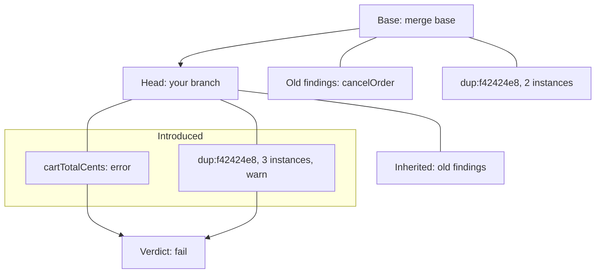

A team that adds fallow to CI in an existing project starts with old findings, and it cannot fix them all first. A CI job that runs `fallow` then fails on each pull request, also on a change that adds nothing wrong. Fallow has three tools that separate new findings from old ones, so CI can block new problems from the first day.

## Which tool do I use?

Pick the tool by the question that you ask. The sections after this one show how each tool works on one pull request.

| Situation | Use |
|:--|:--|
| You want to block a pull request only on the problems that it adds. | [`fallow audit`](#the-changed-code-check) |
| You want to show a developer the findings in the files that they changed. | [`--changed-since`](#scope-a-report-to-changed-files) |
| You run the full project on a schedule or without git history, and only new findings must fail. | [A baseline](#baselines) |
| You want each finding in a changed file to count, but not the findings that you accepted. | `fallow audit --gate all`, with a baseline in `--dead-code-baseline` |

## A pull request in a project with old findings

The demo project has six [findings](/concepts/findings) at `error` in its dead code report, so each run exits with code 1. A pull request adds `src/services/cart-report.ts`, with one new unused export and a copy of a function that exists in two other files.

A CI job that runs `fallow` fails for this pull request. It also fails for each other pull request, because of the old findings, and the author cannot see which findings the change added.

## Scope a report to changed files

The first tool only makes the report smaller. `--changed-since <ref>` keeps the findings of the files that changed since a git ref. These are the files of the commits since the merge base with the ref, plus the changes in the working tree and new files. The merge base is the last commit that your branch and the ref share: the commit where your branch left `main`.

Fallow still analyzes the full project, so a used export stays used. Only the report changes:

| Analysis | What `--changed-since` keeps |
|:--|:--|
| Dead code | The findings in changed files. Unused dependencies stay in the report, because a dependency is unused for the whole project. |
| Duplication | Each clone group with at least one instance in a changed file. |
| Health | The findings and file scores of changed files. |

```bash
npx fallow dead-code --changed-since main
```

```text
● Unused exports (1)
  src/services/cart-report.ts
    :25 cartTotalCents
  Exported symbols with no known consumers

● Unused dependencies (1)
  left-pad
  Listed in dependencies but never imported
```

So `--changed-since` shows the findings of a changed file, old and new: it does not compare with the old state of the code. To judge only what the change added, fallow must compare two versions of the code.

## The changed-code check

A **changed-code check** is a run of `fallow audit`. It runs the dead code, duplication and health analyses on the files that a change touches, and gives one verdict. The **verdict** is the result of the check:

| Verdict | Meaning |
|:--|:--|
| `pass` | The change adds no finding. |
| `warn` | The change adds only findings at `warn`. |
| `fail` | The change adds a finding at `error`. |

The verdict `fail` is a [gate](/concepts/findings#gates): `fallow audit` then exits with code 1.

By default, only the findings that the change introduced decide the verdict. To find them, fallow also analyzes the base of the change and compares the two results. A finding is introduced when the base does not have it. The other findings are inherited: fallow reports them, and they do not change the verdict.

An introduced finding can be outside the changed files. When a change removes the last import of an export, that export becomes unused in a file that the change did not touch. The check reports it. [`fallow audit`](/cli/audit#how-it-works) describes how fallow matches the findings of the two versions.

On the example change, the new unused export is at `error`, so the verdict is `fail`:

```bash
npx fallow audit --base main
```

```text
● Unused exports (1)
  src/services/cart-report.ts
    :25 cartTotalCents

● Duplicates (1 clone group)

     17 lines  3 instances  spread 2  dup:f42424e8
    src/reports/export.ts:3-19
    src/services/cart-report.ts:7-23
    src/utils/summary.ts:7-23

✗ dead code: 1 issue · duplication: 1 clone group · 2 changed files (0.20s)
```

The new copy joins a [clone group](/analysis/duplication) that existed before with two instances. That finding is at `warn`, so without the unused export the verdict is `warn`. In the diagram, the base is at the top and the head of the branch is below it. Only the findings that the base does not have lead to the verdict:



The `--gate` option sets the **audit gate**: the findings that count for the verdict. The default, `new-only`, counts only the introduced findings. With `--gate all`, each finding in the changed files decides the verdict, introduced or not, and fallow does not analyze the base. [`fallow audit`](/cli/audit) has the options.

## Baselines

`fallow audit` needs git and a change to compare. For a full run without a change, for example a nightly job, use a baseline. A **baseline** is a saved file of the current findings. With it, fallow reports only the findings that the file does not hold. A baseline works for the full project, also without git.

```bash
npx fallow dead-code --save-baseline fallow-baseline.json
npx fallow dead-code --baseline fallow-baseline.json
```

The dead code baseline identifies a finding by its file and its name. It does not use the line, so a finding stays known when lines move inside the file. A finding becomes new when its file moves or when its name changes. In the example, a move of `legacy-currency.ts` to `src/old/` makes it a new unused file:

```text
Comparing against baseline: fallow-baseline.json
  3 entry points detected (2 package.json, 1 plugin)

── Unused Code ─────────────────────────────────────

● Unused files (1)
  src/old/legacy-currency.ts
```

Dead code, duplication and health each have their own baseline file. An entry for a finding that you fixed stays in the file. Save the baseline again after a cleanup, or remove the old entries with `fallow baselines prune`. Do not save it again for each merge, because a new finding then becomes a known finding.

## What these tools cannot do

None of the three tools removes old findings. They stay in the code until you fix them.

`--changed-since` and `fallow audit` need git. The base ref must exist in the clone, also in a shallow CI clone.

## Next

- Next: [Evidence levels](/concepts/evidence). Read it before you delete code that fallow reports as unused.
- [Changed code](/analysis/changed-code): run the changed-code check in a project and in CI.
- [Start with a baseline](/guides/baselines): save, use and update a baseline step by step.
