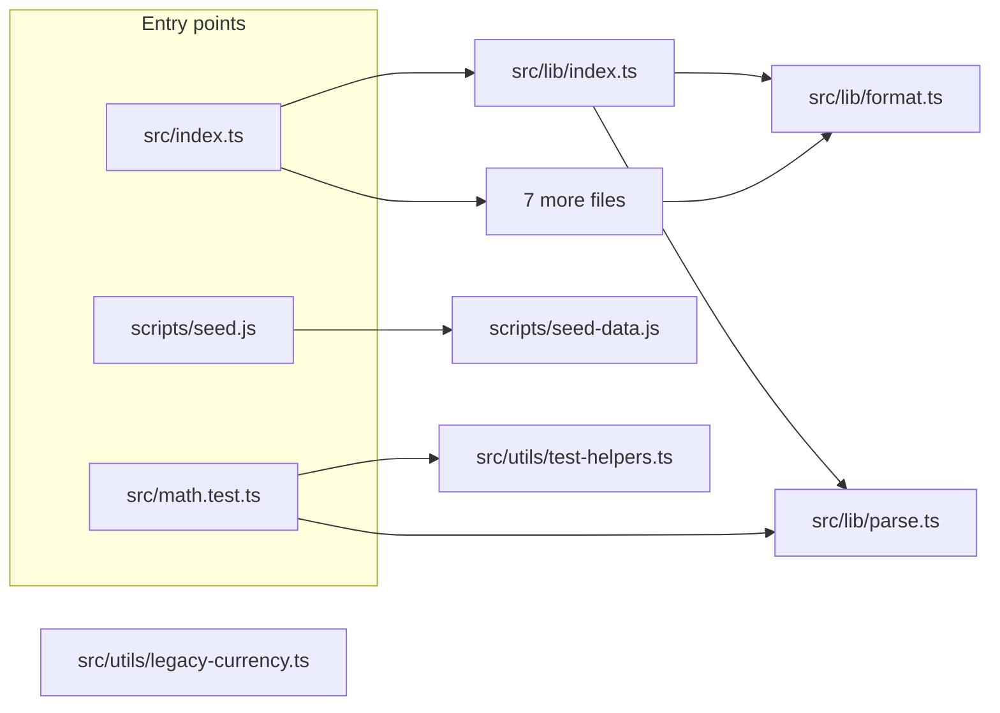
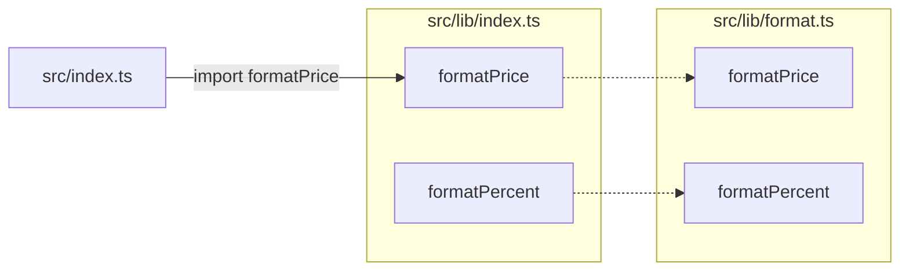

Your report lists `src/utils/legacy-currency.ts` as an unused file, and you want to know why before you delete it. Fallow reports a file as unused when no entry point reaches it. Each dead code finding comes from a walk that starts at the entry points, so when you can follow that walk, you can predict the findings and correct fallow when it is wrong.

The examples use the demo project of the [first run](/quickstart): a small shop app with `"main": "src/index.ts"` in `package.json`, a `seed` script that runs `scripts/seed.js`, and one Vitest test, `src/math.test.ts`.

## The problem

No file imports `legacy-currency.ts`, so it looks unused. But no file imports `src/index.ts` either, and that file is the start of the app.

Imports alone cannot tell these two files apart. Fallow needs one more fact: where the code starts.

## The module graph

Before fallow can look for the start, it needs a map of the imports. Fallow reads each file and records its imports and its exports. It does not run the code. The result is the **module graph**: each file is a node, and each import is a link from one file to another.

An export that a file takes from another file and exports again is a link too. A series of these links is a re-export chain, and fallow follows it to the file that defines the name. Each dead code finding is a fact about this graph, and the other analyses use the same graph, for example to find circular dependencies.

## Entry points

The graph shows which file imports which, but it does not show where the program starts. Entry points give that fact. An **entry point** is a file that something outside your source code runs or loads, for example Node.js, a bundler, a test runner, a framework or a script.

Fallow finds entry points in these places:

| Source | Example | Label in the list |
|:--|:--|:--|
| `package.json` fields | `main`, `module`, `exports`, `bin`, `types`, `typings`, `source`, `browser` | `package.json main`, `package.json bin`, and so on |
| `package.json` scripts | `"seed": "node scripts/seed.js"` makes `scripts/seed.js` an entry point | `package.json script` |
| Framework plugins | Next.js pages, Vitest test files | The plugin name, for example `vitest` |
| CI files | A file that a GitHub workflow or a `.gitlab-ci.yml` job runs with `node` | `scripts` |
| Development container and project files | A file that a lifecycle command of `devcontainer.json`, or a script of a `t3.json` file, runs with `node` | The path of that file, for example `.devcontainer/devcontainer.json` |
| Infrastructure files | A file that a `Dockerfile`, a `Procfile` or `fly.toml` runs | `infrastructure config` |
| Your config file | The [`entry`](/reference/config-files#entry) and [`dynamicallyLoaded`](/reference/config-files#dynamicallyloaded) keys | `manual entry`, `dynamically loaded` |

A [plugin](/concepts/plugins) is the part of fallow that knows one framework or tool. It adds the files that the framework loads by its conventions, and `npx fallow list --plugins` shows the active plugins.

In a script, a CI file or a `Dockerfile`, fallow reads each command. A file that a runtime such as `node` or `tsx` runs becomes an entry point. A file that a formatter, a linter or a file tool such as `cp` only reads does not become an entry point. To ignore the files of one command, add its name to [`ignoreCommandEntries`](/reference/config-dead-code#ignorecommandentries). [Option details of `fallow list`](/cli/list#option-details) has each rule for scripts, CI files, dynamic imports and re-export chains.

When your config file, `package.json` and its scripts name no entry point, fallow uses each file named `src/index`, `src/main`, `index` or `main` (with the extension `.ts`, `.tsx`, `.js` or `.jsx`). The label is `default index`.

To see the entry points of your project, run:

```bash
npx fallow list --entry-points
```

```text
Found 3 entry points
scripts/seed.js (package.json script `seed`)
src/index.ts (package.json main)
src/math.test.ts (vitest)
```

Each line gives the file and its source. The Vitest plugin made the test file an entry point, because `vitest` is in `devDependencies`.

## Reachability

With the entry points known, fallow starts at each one and follows each import. A file that this walk visits is **reachable**. A file that the walk never visits is an [unused file](/rules/unused-file).

In the graph of the demo, the three entry points are in the box. Each arrow is an import, and no arrow leads to `legacy-currency.ts`:



`src/index.ts` reaches the files of `src/lib/` and seven more files: the orders, customers and catalog services, the three reports, and `src/utils/summary.ts`. `scripts/seed.js` reaches `scripts/seed-data.js`. The test reaches `src/lib/parse.ts` and `src/utils/test-helpers.ts`. No path from an entry point leads to `src/utils/legacy-currency.ts`, so fallow reports it as unused.

The walk has one result that surprises people. A file that only an unused file imports is also unused. Two old files that import each other do not keep each other in use.

## Used exports

A reachable file can still hold dead code, so the next question is about each name that the file exports: does a reachable file use this name? An export that no reachable file uses is an [unused export](/rules/unused-export).

| Code in a reachable file | Exports of `./m` that count as used |
|:--|:--|
| `import { a } from "./m"` | `a` |
| `import type { T } from "./m"` | `T` |
| `import * as m from "./m"`, then `m.a` | `a` |
| `import * as m from "./m"`, then `Object.keys(m)` | Each export, except types |
| `const m = require("./m")`, then `m.a` | `a` |
| `const m = await import("./m")`, then `m.a` | `a` |
| `import "./m"` | None. The file is reachable, and its exports are not used. |

### Barrel files

A **barrel file** is a file that exports names from other files again. The demo has one, so that the app can import from `./lib` and not from each file in it:

```ts
// src/lib/index.ts
export { formatPrice, formatPercent } from "./format";
export { parseAmount } from "./parse";
```

Fallow follows each name through the barrel file to the file that defines it, through any number of barrel levels and through `export *`. In the diagram, the solid arrow is the import in `src/index.ts`, and the dotted arrows are the exports of the barrel file:



`src/index.ts` imports only `formatPrice`, and no file imports `formatPercent`, so `formatPercent` is unused. Fallow reports it in two places: on line 3 of `format.ts`, and on line 1 of the barrel file, which exports it again.

### Exports of an entry point

Fallow does not report the exports of an entry point, except in the case below. Code outside your project can use them, for example the users of your package.

One case is different. For some files, a plugin knows the names that the framework reads. In a Next.js page, these names include `default`, `metadata` and `generateMetadata`. Fallow counts those names as used, and it checks the other exports of the file.

To check the exports of the other entry points too, for example `src/index.ts` of a package, use the [`--include-entry-exports`](/cli/global-flags) option or the [`includeEntryExports`](/reference/config-files#includeentryexports) key. You do not need it for the stray exports of a framework file that a plugin knows: fallow reports them without it.

## What fallow cannot follow

Each rule above needs a path that is in the source text. Some paths exist only when the code runs, and fallow cannot follow those.

| Code | Result |
|:--|:--|
| `import("./locales/en.ts")` | Fallow follows the import. |
| ``import(`./locales/${lang}.ts`)`` or `import("./locales/" + lang)` | Fallow counts each file in `./locales/` as reachable. |
| `import.meta.glob(["./pages/*.ts", "!./pages/draft.ts"])` | Fallow counts each file that the patterns match as reachable. |
| `new Worker(new URL("./worker.ts", import.meta.url))` | Fallow follows the path. |
| `path.join(import.meta.dirname, "../scripts/run.ts")`, also with `__dirname` or `path.resolve` | Fallow follows the path. The file is in use, and its exports are not. |
| `spawn(process.execPath, ["scripts/run.ts"], { cwd: ROOT })`, where `ROOT` is a constant that holds such a path | Fallow follows the path from that directory. |
| `import(pathToFileURL(path.join(__dirname, "gen.mjs")).href)` | Fallow follows the import, and the exports of the file are in use. |
| `path.join(repoRoot, "scripts/run.ts")`, where the code gets `repoRoot` when it runs | Fallow cannot follow the path. It reports the file as unused. |
| `const p = "./plugins/" + name; import(p)` | Fallow cannot follow the import. It reports the plugin files as unused. |

For the import that fallow cannot follow, name the files in the `dynamicallyLoaded` key of your config file. Use the `entry` key for a file that something outside the project runs, when fallow did not find it:

```jsonc .fallowrc.jsonc
{ "dynamicallyLoaded": ["src/plugins/*.ts"], "entry": ["src/workers/*.ts"] }
```

## Why does fallow report it?

When a finding surprises you, ask fallow for the reason. For an export, use `--trace` with the file and the name:

```bash
npx fallow dead-code --trace src/lib/format.ts:formatPercent
```

```text
  UNUSED formatPercent in src/lib/format.ts

  File: reachable
  Namespace: value
  Reason: Re-exported through 1 barrel(s) but no consumer imports it through the barrel

  Re-exported through:
    -> src/lib/index.ts as 'formatPercent' (0 ref(s))
```

For a file, use `--trace-file`. It names the entry point when the file is one, and the imports of the file:

```bash
npx fallow dead-code --trace-file scripts/seed.js
```

```text
  REACHABLE scripts/seed.js (entry point, package.json script `seed`)

  Imports from (1):
    <- scripts/seed-data.js
```

[Find why fallow reports a finding](/guides/trace-a-finding) shows each trace command.

## Next

- Next: [Findings, rules and gates](/concepts/findings). It shows what fallow does with each unused file and export, and why a run fails.
- [Plugins](/concepts/plugins): how a framework adds entry points.
- [Production mode](/concepts/production-mode): the same walk, without tests and development tools.
