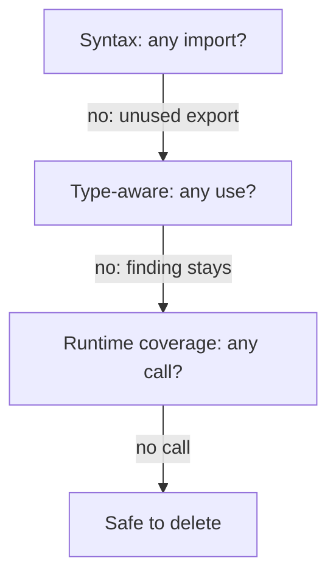

The report says that `cancelOrder` in `src/services/orders.ts` is an unused export. How sure is that finding? A finding from the source text can be wrong when a package or the runtime calls the code, and the app then fails in production after CI passed. By default, fallow reads only the source text. Two opt-in levels add more evidence: the TypeScript type checker, and data from your running app.

## What the report cannot tell you

No file of the demo project imports `cancelOrder`. Before you delete it, you want to know two more facts:

- Does code reach the function in a way that the types show and the imports do not?
- Does the deployed app call the function at all?

The default analysis answers neither question. Each question needs a different level of evidence.

## Three levels

Each level adds a source of facts, and each one costs more to set up than the level before it:

| | Syntax | Type-aware analysis | Runtime coverage |
|:--|:--|:--|:--|
| Turn it on | Default | `--type-aware` | `fallow health --runtime-coverage ./coverage` |
| Source | The source text of each file | The TypeScript type checker | Function calls in a deployed app with real traffic |
| Sees | Files, imports, exports, re-export chains, function bodies | The exact declaration that each use names | The functions that ran during the capture |
| Needs | Nothing more | Node.js 20 or later, and the `fallow-type-aware` package or `fallow type-aware setup` | Coverage data from the app |

### Syntax

The default analysis reads the source text of each file. It does not need Node.js, the TypeScript compiler or installed packages to parse your code. From the text, fallow builds the [module graph](/concepts/entry-points#the-module-graph), and each analysis reads that graph. Unused files, unused exports, copied code, complexity, circular dependencies and boundaries all come from this level.

Syntax cannot see the type of a value. In a call such as `item.render()`, it cannot always tell the class that `render` belongs to. Syntax also cannot see a value that the code computes when it runs, for example a path in a variable or a call such as `handlers[name]()`.

### Type-aware analysis

[Type-aware analysis](/analysis/type-aware) closes the first gap. It runs the TypeScript type checker in a separate process, checks the candidates that the syntax level found, and resolves each use to its exact declaration, also through an alias, a re-export or a method call.

The check can only remove a finding. For unused exports, unused types, unused class members and private type leaks, it does these steps:

- When the checker finds a use of the exact declaration, fallow removes the finding.
- When an interface, an abstract class or a framework contract needs the declaration, fallow removes the finding.
- When the checker finds no use, or cannot decide, fallow keeps the finding.

Type-aware analysis also gives exact symbol traces and the tests that a change of a symbol affects. The cost is a second process with the type checker, and a longer run. Keep `tsc --noEmit` for type errors: fallow does not report compiler errors.

### Runtime coverage

The type checker still reads only the code, so it cannot say if a function ran. [Runtime coverage](/analysis/runtime-coverage) is data about the functions that ran in a deployed app with real traffic. Fallow merges it into the health report and marks each function with one of these values:

| Static result | Calls in the capture | Value |
|:--|:--|:--|
| Unused | None | `safe_to_delete`: the strongest signal to delete |
| Used | None | `review_required`: the function can be seasonal, on an error path, or dead |
| Any | A few, below the low-traffic threshold | `low_traffic` |
| Any | At or above the low-traffic threshold | `active` |
| Any | The capture could not track the function | `coverage_unavailable`: no signal |

The same data also shows which functions handle the most traffic. A function with zero calls did not run during the capture. It can still run later: at the end of the year, after an error, or for one customer. A short capture or low traffic makes this more likely.

## Can I delete this function?

Each level removes one kind of doubt, so a delete decision can use all three. The diagram takes `cancelOrder` through the levels, from the top down:

Syntax finds no import, so fallow reports an unused export. When the type checker also finds no use of the declaration, the finding stays. When the capture then shows no call, runtime coverage marks the function `safe_to_delete`. A use at any level stops the walk: the type checker removes the finding, or runtime coverage marks the function `active` or `low_traffic`.

## What static analysis can never know

Syntax and the type checker both read the code. They do not run it, so they cannot know these facts:

- If a path through the code runs. A reachable function is a function that can run, not a function that ran.
- A value from outside the program: an environment variable, user input, a response from a server, or a file name that a config computes.
- A call by a name in a string, for example through reflection or a registry of handlers.
- A user of your published package in another repository.

Runtime coverage answers only the first question, and only for the period of the capture. [Known limits of fallow](/guides/limits) gives the known gaps and the fix for each.

## Next

- Next: [Production mode](/concepts/production-mode). Read it to find code that only your tests keep in use.
- [Type-aware analysis](/analysis/type-aware): install the checker and read its results.
- [Runtime coverage](/analysis/runtime-coverage): collect coverage from a deployed app.
