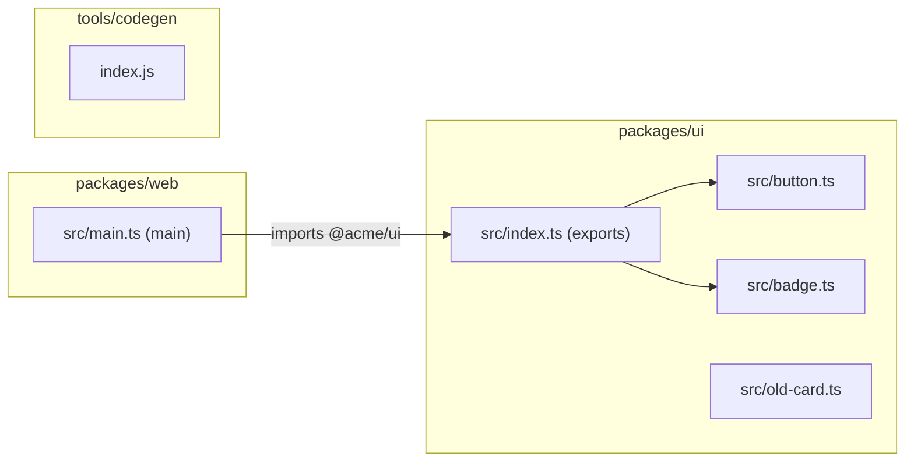

Your monorepo holds many packages, and the packages import each other. An export that only a sibling package uses is still a used export, so fallow analyzes all packages as one project and sees each import between them. It also tells you when it does not find a package, because the files of that package then show as unused.

The demo project has one package, so this page uses a small monorepo with two packages and one folder that no workspace pattern declares:

```text
package.json                    "workspaces": ["packages/*"]
packages/ui/package.json        "name": "@acme/ui", "exports": { ".": "./src/index.ts" }
packages/ui/src/index.ts        exports Button and Badge from ./button and ./badge
packages/ui/src/old-card.ts
packages/web/package.json       "name": "@acme/web", "main": "src/main.ts"
                                "dependencies": { "@acme/ui": "*", "left-pad": "^1.3.0" }
packages/web/src/main.ts        imports Button from "@acme/ui"
tools/codegen/package.json      "name": "@acme/codegen", "main": "index.js"
tools/codegen/index.js
```

## The problem

`packages/web` imports `Button` from `@acme/ui`. A tool that analyzes each package alone sees no use of `Button` in `packages/ui`, and reports it as unused. If you delete `Button`, the web app breaks. A tool that does not know the packages also does not know that `packages/web/src/main.ts` is an [entry point](/concepts/entry-points).

## Workspaces

To avoid both errors, fallow must first know the packages. A **workspace** is one package of a monorepo, as the workspace patterns of the package manager declare it. Fallow reads these declarations and adds the packages of each one together:

| Source | Example |
|:--|:--|
| The `workspaces` field of the root `package.json` (npm, Yarn, Bun) | `"workspaces": ["packages/*"]` |
| `pnpm-workspace.yaml` | `packages: ["packages/*", "apps/*"]` |
| The `workspace` field of a root `deno.json` or `deno.jsonc` | `"workspace": ["./packages/*"]` |
| The `references` field of the root `tsconfig.json` | `"references": [{ "path": "./packages/core" }]` |
| `link:` and `file:` dependencies in the root `package.json` | `"@acme/ui": "link:./packages/ui"` |

When the project declares no workspace patterns, fallow uses each folder with a `package.json` up to two levels below the root. The [`workspaces.patterns`](/reference/config-workspaces#workspaces-patterns) key of the config file adds more patterns.

To see the workspaces that fallow found, run:

```bash
npx fallow list --workspaces
```

```text
Discovered 2 workspaces
  @acme/ui -> packages/ui (internal dep)
  @acme/web -> packages/web
1 workspace discovery diagnostic:
  - Directory 'tools/codegen' contains package.json but is not declared as a workspace. Add it to package.json workspaces or pnpm-workspace.yaml, or add it to ignorePatterns.
```

`internal dep` marks a workspace that another workspace depends on.

## How fallow analyzes a monorepo

With the workspaces known, fallow builds one [module graph](/concepts/entry-points#the-module-graph) for all of them. In the diagram, each box is a folder with a `package.json`, and each arrow is an import. The import of `@acme/ui` crosses from one package to the other:



Each workspace adds these facts to the graph:

- **Entry points.** Fallow reads the `package.json` fields and scripts of each workspace, from the folder of that workspace. Here, `packages/ui/src/index.ts` comes from `exports`, and `packages/web/src/main.ts` comes from `main`. When a field names a build output file, for example `./dist/index.js`, fallow uses the source file at the same path under `src/`.
- **Plugins.** Fallow turns on the [plugins](/concepts/plugins) of each workspace from its own `package.json`. A Vitest dependency in `packages/web` makes the test files of `packages/web` entry points, and not the test files of `packages/ui`.
- **Imports between packages.** An import of `@acme/ui` goes to the source files of `packages/ui`. Fallow follows the link of the package manager in `node_modules` to the real file, and records the use there. Run the install of your package manager before you run fallow. The `package.json` of the importing workspace must list the package. Otherwise fallow reports an unlisted dependency.

`packages/ui/src/index.ts` is an entry point, so fallow does not report its exports, also `Badge`, which no package imports. A package entry point is the public API of the package. No arrow leads to `old-card.ts`, and no arrow leads to `tools/codegen/index.js`, because fallow did not read the `package.json` of that folder.

## What fallow reports for each package

One graph gives one report, but each finding still belongs to one package. Some findings belong to a file, and some belong to a `package.json`:

- A finding in a file, for example an unused file or an unused export, has the path of the file. The path shows the workspace.
- A dependency finding belongs to the `package.json` of one workspace. An unused dependency names the `package.json` that lists it. An unlisted dependency is a package that a file imports, and that the `package.json` of its workspace does not declare.

```bash
npx fallow dead-code
```

```text
● Unused files (2)
  packages/ui/src/old-card.ts
  tools/codegen/index.js
  Files not reachable from any entry point
  https://fallow.tools/docs/explanations/dead-code/#unused-files

── Dependencies ─────────────────────────────────────

● Unused dependencies (1)
  left-pad (packages/web/package.json)
  Listed in dependencies but never imported
```

## Scope the report

In a large monorepo, you often want the findings of one package only. Fallow always analyzes all workspaces, and these options change only the report:

- `--workspace <name>` reports the findings of the workspaces that you name. A name can be a package name, a path or a glob, for example `@acme/ui` or `apps/*`.
- `--changed-workspaces <ref>` reports the findings of each workspace that has a file change since the git ref.

```bash
npx fallow dead-code --workspace @acme/web
```

```text
● Unused dependencies (1)
  left-pad (packages/web/package.json)
  Listed in dependencies but never imported
```

Fallow still reads all packages, so in a report for `@acme/ui`, `Button` stays used, because `packages/web` imports it. You cannot use the two options together.

## A package that fallow does not find

The usual failure is a package that no workspace pattern declares. Fallow does not read the `package.json` of that package for entry points, so its files become unused files. In the example, `tools/codegen/index.js` is the `main` file of a package, and fallow reports it.

`fallow list --workspaces` shows the cause. Each folder with a `package.json` that no pattern declares gets a diagnostic. To fix it, do one of these steps:

- Add the folder to the workspace patterns of your package manager.
- Add the folder to [`workspaces.patterns`](/reference/config-workspaces#workspaces-patterns) in the config file, when the package manager must not install it.
- Add the folder to `ignorePatterns`, when fallow must not analyze it.

## Next

- Next: [Dead code](/analysis/dead-code). The analyses start here: find unused files and exports, also in each workspace.
- [Set up fallow in a monorepo](/guides/monorepo): the setup, step by step.
- [Workspace configuration](/configuration/workspaces): the config keys for each workspace.
