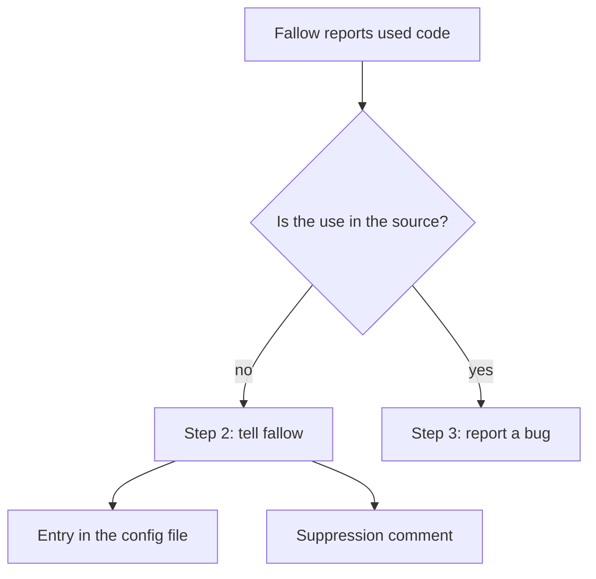

Fallow reports a file as unused, and you know that your app loads it. If you delete it, the app breaks. If you suppress it, the next reader does not know why the file stays. At the end of this guide, fallow sees each use of the code that it reported, and your config file records the cause.

The example on this page adds three things to the demo project: an exporter `src/plugins/csv.ts`, a loader `src/loader.ts` that builds the import path from a name, and a call `loadExporter("csv")` in `src/index.ts`:

```ts
// src/loader.ts
export const loadExporter = async (name: string) => {
  const path = "./plugins/" + name + ".ts";
  return import(path);
};
```

The app loads the exporter on each run, but fallow reports it:

```text
● Unused files (2)
  src/plugins/csv.ts
  src/utils/legacy-currency.ts
  Files not reachable from any entry point
```

A false positive is a [finding](/concepts/findings) for code that is in use. The path `./plugins/csv.ts` exists only when the loader runs, so no import in the source text leads to the file. Each fix below puts that missing link into the config file.

## Before you start

- Make sure that the code is really in use. Search for the name, and check the files that start your app.
- Install the dependencies. Without `node_modules`, fallow cannot read the exports of packages.

## Steps

### 1. Trace the finding

Before you change the config, find out where fallow looked. For a file, use `--trace-file`:

```bash
npx fallow dead-code --trace-file src/plugins/csv.ts
```

```text
  UNREACHABLE src/plugins/csv.ts

  Exports (1):
    export run [unused]
```

`UNREACHABLE` means that no path of imports leads from an entry point to the file. For an export, use `--trace <file>:<name>`. For a package, use `--trace-dependency`. [Find why fallow reports a finding](/guides/trace-a-finding) shows each command and its output.

A missing path often starts at a missing entry point. Run two commands, and compare their lists with the way your project starts:

- `npx fallow list --entry-points` shows each entry point and the source that made it one, for example a `package.json` script or a plugin. A file that your project runs and that is not in this list makes its imports look unused.
- `npx fallow list --plugins` shows the plugins that are on. A framework that you use and that is not in this list adds no entry points.

### 2. Match the cause to the fix

The trace tells you where the path stops. The next question decides the rest of this guide:



When the use is not in the source text, as for the loader above, you tell fallow about it. Use a config entry when one of the causes below fits, and a suppression comment only for the last row. Find the row that describes the use that fallow cannot see. Use the fix of that row, and use no wider fix.

| Cause | Example | Fix |
|:--|:--|:--|
| A framework loads files by a convention, and fallow has no plugin for it. | An internal job runner loads each file in `src/jobs/`. | Check [Built-in plugins](/frameworks/built-in). If no plugin fits, [write a plugin](/guides/custom-plugins). For one or two files, add them to [`entry`](/reference/config-files#entry). |
| The code builds the path of an import at run time. | `src/loader.ts` above. | Add the files to [`dynamicallyLoaded`](/reference/config-files#dynamicallyloaded). |
| A program outside your source code runs the file. | A deploy tool starts `ops/migrate.ts`. | Add the file to [`entry`](/reference/config-files#entry). |
| The browser or a server loads the file by its path, and no file imports it. | A service worker in `public/sw.js`, or a script that only an HTML file names. | Add the file to [`entry`](/reference/config-files#entry). The path is fixed, so `dynamicallyLoaded` is not the key for it. |
| Code outside the repository imports the export. | Another repository imports a helper of your package. | See [Code used outside the repository](/guides/limits#code-used-only-outside-the-repository). |
| Vitest loads a manual mock, and fallow cannot see the mock call. | `vi.mock(modulePath)` with a variable, so fallow reports `src/lib/__mocks__/parse.ts` as an unused file. | Write the path as a string in the `vi.mock` call, or add the file to [`entry`](/reference/config-files#entry). [Manual mocks](/frameworks/built-in#manual-mocks) has the rule. |
| A package is used without an import. | The runtime loads a native module, or a peer supplies it at deploy time. | Add the package to [`ignoreDependencies`](/reference/config-dead-code#ignoredependencies). |
| Only a config file names the package, and no plugin reads that file. | The JSON config of an internal tool names `@acme/lint-preset`. | Add the package to [`ignoreDependencies`](/reference/config-dead-code#ignoredependencies), for example `"ignoreDependencies": ["@acme/lint-preset"]`. [Dependencies](/analysis/dependencies) lists the files that fallow reads. |
| A library calls a class member by its name. | A migration runner calls `up()` and `down()`. | Add the names to [`usedClassMembers`](/reference/config-dead-code#usedclassmembers), scoped with `extends` or `implements`. |
| A decorator does not mean that a framework calls the member. | Your own `@log` decorator on an unused method. | Fallow skips each decorated member. Add the decorator to [`ignoreDecorators`](/reference/config-dead-code#ignoredecorators) to check these members again. |
| A tool generates the file. | `src/generated/api.ts` from an OpenAPI schema. | Add the directory to [`ignorePatterns`](/reference/config-files#ignorepatterns). |
| None of the above: a real limit of static analysis. | A value that only the runtime knows. | [Suppress the finding](/guides/suppress) and give the reason. |

For the loader of the example, name the files that it can load:

```jsonc
// .fallowrc.jsonc
{
  "dynamicallyLoaded": ["src/plugins/*.ts"]
}
```

Fallow makes each matching file an entry point. The file and its imports become [reachable](/concepts/entry-points#reachability), and the next run reports only the real unused file:

```text
● Unused files (1)
  src/utils/legacy-currency.ts
  Files not reachable from any entry point
```

The glob also covers the next exporter that somebody adds to `src/plugins/`. That is the reason to prefer the config: a config entry tells the next reader why the code stays, and a suppression comment on each finding hides the same fact in many places. Prefer the config when more than one finding has the same cause.

### 3. Report a bug when fallow is wrong

Sometimes the use is in the source text, and fallow still reports the code. For example, a plain `import { a } from "./m"` in a reachable file, and fallow reports `a` as unused. That is a bug in fallow, and no config entry is the right fix.

Open an issue at [github.com/fallow-rs/fallow/issues](https://github.com/fallow-rs/fallow/issues/new/choose). Give this information:

- the output of `fallow --version`,
- a minimal project that shows the problem, or a link to a public repository,
- your config file,
- the command, the output, and the result that you expected,
- the output of the trace command for the finding.

Until the fix is released, suppress the finding with a reason that names the issue.

## Check the result

Run the trace again:

```bash
npx fallow dead-code --trace-file src/plugins/csv.ts
```

```text
  REACHABLE src/plugins/csv.ts (entry point)
```

The file is reachable, and `npx fallow dead-code` no longer lists it. For an export, the status of `--trace` changes from `UNUSED` to `USED`. For a suppressed finding, the summary line counts it as suppressed.

## If it fails

| Problem | Cause | Fix |
|:--|:--|:--|
| The finding is still reported after the config change. | Fallow did not load the config file, or the glob does not match. | Look for the `loaded config:` line in the output. Check the glob against the paths of `fallow list --files`. |
| A plugin is not in `list --plugins`. | The package that turns the plugin on is not in `package.json`. | Add the package, or add the files to `entry`. |
| A `usedClassMembers` entry has no effect. | The class does not name the base type in `extends` or `implements`. | Use a plain member name, or change the scope. |
| Fallow says that a config entry hid nothing. | The entry is not needed, or it has a typing error. | Remove the entry, or correct it. |

## Related

- Next: [Suppress a finding](/guides/suppress). Use it for the last row of the table, with a reason.
- [Known limits of fallow](/guides/limits): what fallow cannot know, and the fix for each limit.
- [Plugins](/concepts/plugins): how fallow learns the conventions of a framework.
