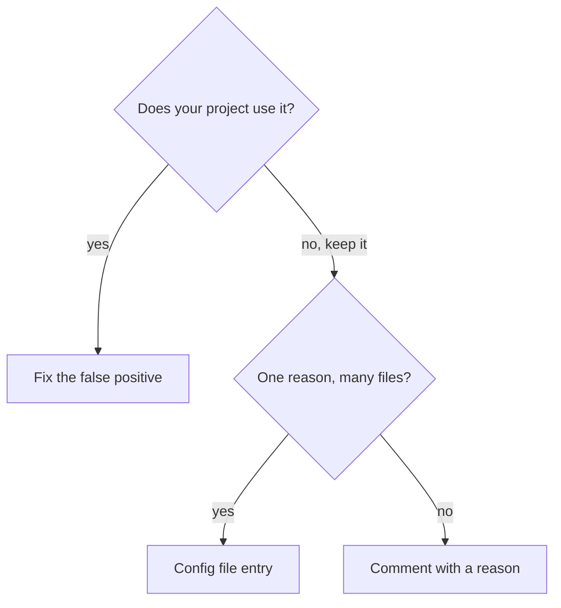

You checked a [finding](/concepts/findings), and you keep the code on purpose. In the demo project, no file calls `cancelOrder`, but your support team runs it by hand to fix a stuck order. Each run reports it again, and the run fails on it. At the end of this guide, fallow hides this one finding, and the code says why.

A suppression hides a finding from each later run, so pick it last. Follow the question that fits your finding:



When fallow reports code that your project uses, [fix the false positive](/guides/false-positives): a config entry tells fallow the missing fact, and it fixes each finding of that kind. For an export that another repository imports, `/** @public */` is that fix. When the same reason applies to many files, put it in the config file. Use a comment only when the code is correct and no config models the reason.

## Before you start

- Know the [issue type](/concepts/findings) of the finding. The report prints it in the suppression hint, for example `To suppress: // fallow-ignore-next-line unused-export`.
- Know the reason in one sentence. When you cannot write the reason, do not suppress the finding.

## Steps

### 1. Choose the narrowest mechanism

A wide suppression also hides the findings that the next change adds. Pick the smallest scope that covers your finding:

| Scope | Mechanism | Use it when |
|:--|:--|:--|
| One line | `// fallow-ignore-next-line <issue-type>` | One export, one function or one import is correct as it is. |
| One unused export that must become used | `/** @expected-unused */` | You keep an export for a known consumer that does not exist yet. |
| A block of lines | `// fallow-ignore-start code-duplication` and `// fallow-ignore-end code-duplication` | You keep one copied block. Ranges work only for duplication. |
| One file | `// fallow-ignore-file <issue-type>` | The finding is about the whole file, for example an unused file. |
| A rule for many files | The config file: [`rules`](/reference/config-rules#rules), [`overrides`](/reference/config-rules#overrides), [`ignoreDependencies`](/reference/config-dead-code#ignoredependencies) | The same reason applies to a set of files or packages. |

Always name the issue type. A comment without an issue type suppresses each issue type on that line or in that file, also the findings that you have not seen.

### 2. Add the comment with a reason

Write the reason after ` -- `. The next person who reads the code then knows why the export stays. For `cancelOrder`:

```ts
// src/services/orders.ts
// fallow-ignore-next-line unused-export -- support runs it by hand to fix a stuck order
export const cancelOrder = (order: Order): Order => ({ ...order, quantity: 0 });
```

For a whole file, put the comment at the top of the file:

```ts
// src/utils/legacy-currency.ts
// fallow-ignore-file unused-file -- reference code for the guilder conversion
export const toGuilders = (euros: number): number => euros * 2.20371;
```

For a complex function, the token is `complexity`. It hides the cyclomatic, cognitive and CRAP findings together. `// fallow-ignore-next-line complexity` goes on the line above the function. `// fallow-ignore-file complexity` at the top of the file hides the complexity findings of each function in the file, and the file length finding.

For a copied block, put the two markers on their own lines around it:

```ts
// src/reports/export.ts
// fallow-ignore-start code-duplication -- the export format must stay independent
export const exportCartSummary = (items: Item[]): string => {
  // ...
};
// fallow-ignore-end code-duplication
```

In an HTML file or a Vue template, use `<!-- fallow-ignore-file <issue-type> -->`. [Suppression comments and tags](/configuration/suppression) lists each comment form and the issue types that each one accepts.

### 3. Run fallow again

Check that the comment hides the finding that you meant, and nothing else:

```bash
npx fallow dead-code --unused-exports
```

```text
● Unused exports (2)
  src/lib/format.ts
    :3 formatPercent
  src/lib/index.ts
    :1 formatPercent (re-export)
  Exported symbols with no known consumers
  https://fallow.tools/docs/explanations/dead-code/#unused-exports

✗ 2 exports (0.07s)
  2 issues · 1 suppressed
```

`cancelOrder` is gone from the list, and the last line counts it as suppressed. The two `formatPercent` findings stay, because the comment names one line.

### 4. Review the suppressions

Over time, a project collects suppressions, and some lose their reason. List them all:

```bash
npx fallow suppressions
```

```text
● Suppression inventory (1)
  src/services/orders.ts
    :18 unused-export reason: support runs it by hand to fix a stuck order

● Totals by kind
  unused-export: 1

✓ 1 suppression in 1 file, 0 without reasons, 0 stale (0.02s)
```

The inventory lists each suppression and its reason. It counts the suppressions without a reason, so a review finds them.

## Check the result

A suppression can become stale. The code changes, and the finding goes away, but the comment stays and tells the next reader something false. Fallow reports a stale suppression as a finding of its own. To see it, add an import of `cancelOrder` to `src/index.ts`, and run fallow again:

```bash
npx fallow dead-code
```

```text
● Stale suppressions (1)
  src/services/orders.ts:18:0 // fallow-ignore-next-line unused-export -- support runs it by hand to fix a stuck order (no unused-export issue found on the next line)
  Suppression comments or JSDoc tags that no longer match any issue
  https://fallow.tools/docs/explanations/dead-code/#stale-suppressions
```

The same happens to `@expected-unused` when a file starts to use the export:

```text
● Stale suppressions (1)
  src/services/orders.ts:19:13 @expected-unused on cancelOrder (cancelOrder is now used)
```

Remove the stale comment. The default severity of [`stale-suppression`](/rules/stale-suppression) is `warn`, so a stale comment alone does not fail the run.

A config entry can become stale too. For `ignoreDependencies`, fallow prints a note. The demo project uses `zod`, so an entry `"ignoreDependencies": ["zod"]` hides nothing:

```text
Note: ignoreDependencies entry hid no dependency finding this run: zod (remove from the config).
```

## If it fails

When the finding stays, or the suppression does not do what you expect, check these causes:

| Problem | Cause | Fix |
|:--|:--|:--|
| The finding is still reported. | The comment is not on the line directly above the finding, or the issue type is wrong. | Copy the comment from the `To suppress:` hint of the report. |
| A stale suppression says `is not a recognized fallow issue kind`. | The issue type in the comment has a typing error. | Use the name that the message proposes, or the id from [Issue types](/reference/issue-types). |
| A range has no effect. | A range marker names another issue type than `code-duplication`, or it shares its line with code. | Put each marker on its own line. For other issue types, use one comment for each finding. |
| Many comments give the same reason. | The reason is a fact about the project. | Move it to the config file, and remove the comments. [One reason in many files](/configuration/suppression#config-level-vs-inline-suppression) has an example. |

## Related

- [Suppression comments and tags](/configuration/suppression): each comment form and each config key.
- [Fix a false positive](/guides/false-positives): the fixes that are better than a suppression.
- [`fallow suppressions`](/cli/suppressions): the inventory command.
