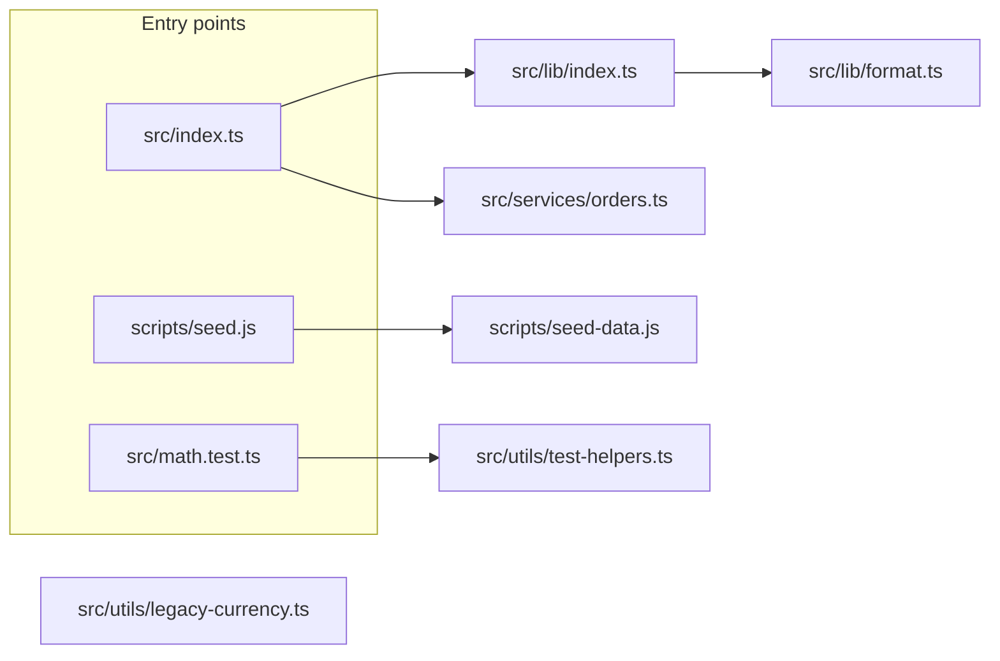

Fallow finds the code in your TypeScript or JavaScript project that nothing uses, the code that you copied, and the functions that are hard to change. It reads the whole repository and needs no config file. Run it on your machine, on each pull request, and in the loop of a coding agent.

This is the report of `npx fallow` on a small demo project with 16 files:

```text
  16 files analyzed
  3 entry points detected (2 package.json, 1 plugin)

● Unused files (1)
  src/utils/legacy-currency.ts

● Unused dependencies (1)
  left-pad

● Duplicates (1 clone groups)

     17 lines  2 instances  spread 2  dup:f42424e8
    src/reports/export.ts:3-19
    src/utils/summary.ts:7-23

● High complexity functions (1)
  src/services/customers.ts
    :9 classifyCustomer CRITICAL

Failed: dead-code (6 issues), dupes (1 clone group), health (1 above threshold): start with src/services/customers.ts
```

This run found a file that nothing imports, a package that no file uses, a block of 17 lines that exists in two files, and one function to split first. The full report also lists unused exports and a package that the code imports but `package.json` does not list.

## How fallow knows that code is unused {#how-it-works}

A linter checks one file at a time. Fallow builds one graph of all files and their imports. It starts at the [entry points](/concepts/entry-points), the files that something outside your code runs, such as the `main` file of `package.json` or a test file. Then it follows each import. In the graph below, the three entry points of the demo reach each file except `src/utils/legacy-currency.ts`:



No import path leads to `legacy-currency.ts`, so fallow reports it as an unused file. An export is unused when no reachable file uses it.

## Start here

1. [Install fallow](/installation), or run it with `npx` and install nothing.
2. [Try it on your project](/quickstart): run one command and read each part of the report.
3. [Fix your first findings](/start/first-cleanup): check a finding, remove the code, and run fallow again.

After the first run, add fallow where your team changes code:

- [Check each pull request](/start/first-ci): add one workflow file, and fallow checks the code that each pull request changes.
- [Use it with a coding agent](/start/first-agent): let Claude Code, Codex or Cursor check their own changes before they commit.

Do you use another tool for dead code or duplication? [Fallow and linters](/explanations/fallow-vs-linters) shows which problem needs which tool. The migration pages move your settings from [knip](/migration/from-knip), [ts-prune](/migration/from-ts-prune), [jscpd](/migration/from-jscpd), [madge](/migration/from-madge), [dependency-cruiser](/migration/from-dependency-cruiser) and [Stylelint](/migration/from-stylelint).

## What fallow analyzes

- [Dead code](/analysis/dead-code): unused files, exports, types and class members.
- [Dependencies](/analysis/dependencies): packages that `package.json` lists and no file uses, and packages that files use and `package.json` does not list.
- [Duplication](/analysis/duplication): blocks of code that exist in two or more places.
- [Health](/analysis/health): complexity, a score for each file, and the files to refactor first.
- [Architecture](/analysis/architecture): circular dependencies and imports that break your boundary rules.

You run these analyses on request: [styling](/analysis/styling), [feature flags](/analysis/feature-flags), [security](/analysis/security), [similar code](/analysis/similar-code), [mutation testing](/analysis/mutation), [type-aware analysis](/analysis/type-aware) and [runtime coverage](/analysis/runtime-coverage). To learn which functions run in production, add [Fallow Cloud](/cloud/beacon): it counts how often each function of your deployed app runs, and fallow shows these counts in the health report.

## Next

- [First run](/quickstart): run `npx fallow` on your project and read the report.
- [Entry points and reachability](/concepts/entry-points): how fallow decides that code is unused.
