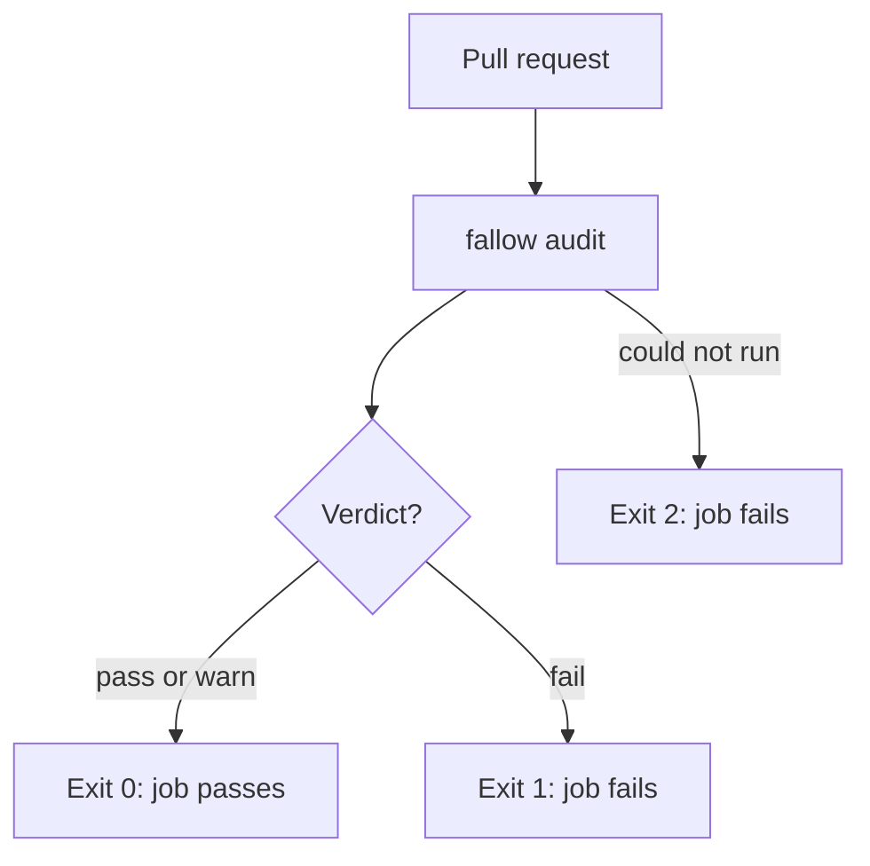

Your team merges pull requests each day, and each one can add an export that nothing imports or a block that another file already has. A review often misses these, because the diff looks correct. In the demo project, a pull request adds `cartTotalCents` to `src/services/cart-report.ts`, and no file imports it. A CI job that runs fallow fails on that pull request, before the merge. This page helps you choose the setup for your CI system, and gives the job for a system that has no fallow integration.

## Choose a setup

GitHub and GitLab have an integration that posts the result on the pull request. On another system, you run the `fallow` command in a job step.

| Your CI | Setup | Page |
|:--|:--|:--|
| GitHub Actions | The `fallow-rs/fallow` action. It posts a comment, a check, annotations and a job summary. | [GitHub Actions](/integrations/ci-github) |
| GitLab CI | The fallow CI template. It posts a merge request comment and a Code Quality report. | [GitLab CI](/integrations/ci-gitlab) |
| Another CI system | The `fallow` command in a job step. | [Any other CI](#any-other-ci) on this page |
| A Git hook on each developer machine | `fallow hooks install --target git` writes a pre-commit hook that runs `fallow audit --staged`. | [`fallow hooks`](/cli/hooks) |

[What fallow posts on a pull request](/integrations/ci-comments) shows each surface that the two integrations write.

## Run the changed-code check

Each setup above runs the same command on a pull request: `fallow audit`. This is the [changed-code check](/concepts/changed-code). Fallow runs the analyses on the files that the pull request changes, and gives one verdict: `pass`, `warn` or `fail`.

The audit fits a pull request for two reasons:

- The verdict counts only the findings that the change adds. An old finding in a changed file does not fail the pull request, so you can add the job to a project that has many findings today.
- The verdict follows the severity of each [rule](/concepts/findings#rules-and-severities). A finding at the `warn` level gives `warn`, and the job passes.

The audit has nothing to compare on the default branch. There, a run without a command (bare `fallow`) analyzes the whole project, for example on a schedule. To make that full run fail only on new findings, save a [baseline](/concepts/changed-code#baselines) and pass it with `--baseline`.

## Exit codes and gates {#gates}

The CI system reads only the exit code of the job. The diagram shows how the verdict of the audit becomes that exit code:



The job fails when `fallow audit` exits with code 1 (verdict `fail`) or code 2 (fallow could not run), so do not hide the exit code with `|| true`. [Gates](/concepts/findings#gates) explains each condition that fails a run, and [Exit codes](/reference/exit-codes) lists each code.

## Any other CI {#any-other-ci}

Jenkins, CircleCI, Bitbucket Pipelines, Azure Pipelines and other systems have no fallow integration. The job below works on each CI system that can run Node.js 22 or later.

### Before you start

- Add fallow to the development dependencies of the project: `npm install --save-dev fallow`. CI then runs the same version as your team. [Install](/installation) lists the other ways.
- The job needs the git history of the base branch, so that fallow can compare the change with it.

### Steps

1. Check out the repository with its full history, and fetch the base branch. A shallow clone, for example with depth 1, has no merge base.
2. Install the dependencies. Fallow reads the packages in `node_modules`, and without them it can report wrong dependency findings.
3. Run the audit against the base branch:

```bash
# ci/fallow.sh
set -euo pipefail

git fetch origin main
npm ci
npx fallow audit --base origin/main --quiet
```

The job fails when the verdict is `fail`. `--base` is an alias of `--changed-since`. Without `--base`, fallow finds the base itself. [`fallow audit`](/cli/audit#base-ref) gives the order, and [`FALLOW_AUDIT_BASE`](/configuration/environment#fallow_audit_base) pins it.

### Write a report for your CI system

The job log shows the findings, but most CI systems can also show a report file next to the job. Choose the format that your system reads:

| Format | Content | Typical reader |
|:--|:--|:--|
| `sarif` | SARIF 2.1.0 | GitHub code scanning, Azure DevOps, SARIF viewers |
| `codeclimate` | A Code Climate JSON array. The aliases are `gitlab-codequality` and `gitlab-code-quality`. | GitLab Code Quality, Code Climate readers |
| `github-annotations` | GitHub workflow commands (`::error file=...`) | The GitHub Actions log |
| `github-summary` | Markdown for `$GITHUB_STEP_SUMMARY` | The GitHub Actions job summary |
| `markdown` | A Markdown report | A comment that your own script posts |
| `json` | The full result | Your own script |

You do not need one analysis for each format. Save the JSON result once, then render each format from that file with [`fallow report`](/cli/report):

```bash
npx fallow audit --base origin/main --quiet --format json --output-file fallow.json
npx fallow report --from fallow.json --format sarif --output-file fallow.sarif
npx fallow report --from fallow.json --format codeclimate --output-file gl-code-quality-report.json
```

The first command still exits with code 1 on a `fail` verdict. When your CI system stops at the first failed command, run the two `report` commands in a step that always runs.

The CI formats give each path relative to the repository root, also when the project is in a subdirectory of the repository. Fallow finds this offset with git. To set it yourself, use [`--report-path-prefix`](/cli/global-flags).

### Cache the analysis

Each job starts on a clean machine, so without a cache fallow parses each file again. Fallow keeps a parse cache in `.fallow/` in the project root, and with that folder a later run parses only the changed files. Save and restore the folder with the cache of your CI system. Use a key that changes with the lockfile, so that a dependency update starts a new cache. To move the folder, set [`cache.dir`](/reference/config-files#cache) in the config file.

## Check the result

To see the job fail once, open a pull request that adds an unused export, for example `cartTotalCents` in the demo project. The job log shows the finding, and the job fails:

```text
● Unused exports (1)
  src/services/cart-report.ts
    :25 cartTotalCents
  Exported symbols with no known consumers
```

## If it fails

Most first failures come from the checkout or the install step, not from fallow:

- **The audit says that it "compared no changed files".** The base ref is the same commit as `HEAD`, for example on a push to `main`. Run the audit on pull requests, or pass the branch to compare with in `--base`.
- **Exit code 2 with "could not determine changed files".** The clone has no history of the base branch. Fetch the base branch, or clone with full history.
- **Many unused dependencies.** The job did not install the dependencies. Run the install step before fallow.
- **The job passes, but the findings show.** The job runs bare `fallow` with a machine format, which has no gate on findings by default. Use `fallow audit`, or add `--fail-on-issues` (see [Gates](#gates)).

## Mutation testing {#mutation-testing}

The audit tells you that the change adds no unused or copied code. It does not tell you that the tests catch a bug in the change. For that, the GitHub Action and the GitLab template can run [`fallow mutation`](/cli/mutation) on the changed lines before the analysis. See [Mutation testing on GitHub](/integrations/ci-github#mutation-testing) and [Mutation testing on GitLab](/integrations/ci-gitlab#mutation-testing).

## Related

- Next: [GitHub Actions](/integrations/ci-github) or [GitLab CI](/integrations/ci-gitlab). Each page gives the workflow file for its platform.
- [What fallow posts on a pull request](/integrations/ci-comments)
