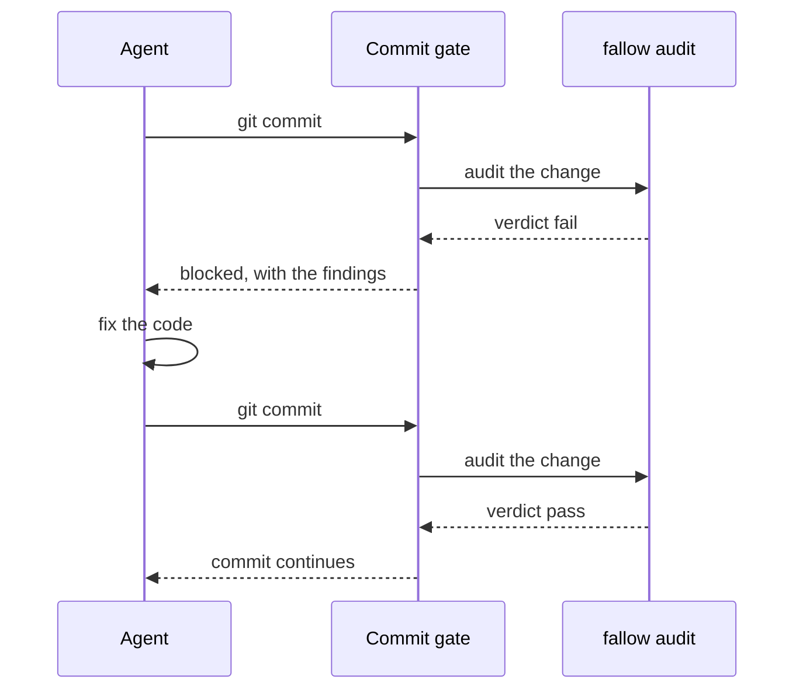

`AGENTS.md` tells your coding agent to run `fallow audit` before it commits, but an agent can skip a step of its instructions. In the demo project, an agent adds `describeOrder` to `src/services/orders.ts`, nothing calls it, and the agent commits. The **commit gate** stops that commit. It is a hook that runs `fallow audit` before Claude Code or Codex commits or pushes, and blocks the command when the audit fails. The agent then gets the findings, fixes the code, and tries again.

## How the commit gate works

The commit gate is a `PreToolUse` hook on the shell tool of the agent, so it runs before each shell command of the agent. It is not a Git hook: when you run `git` in a terminal, the hook does not run. Follow the commit of the agent from left to right:



For each `git commit` and `git push`, the hook runs this command:

```bash
fallow audit --format json --quiet --explain --gate-marker agent
```

- On the verdict `pass` or `warn`, the command continues.
- On `fail`, the hook blocks the command and gives the agent a short list of the findings.
- When the audit cannot run, for example on an invalid config, the hook writes a notice and lets the command continue.

The audit uses the default [`audit.gate`](/reference/config-rules#audit-gate) value `new-only`, so only the findings that the change adds block a commit. An old finding in the same file, such as `cancelOrder`, does not. [Changed code](/concepts/changed-code) explains the verdict. Keep the check in CI too, because the commit gate checks only the commands that the agent runs.

## Before you start

- Add fallow to the development dependencies of the project: `npm install --save-dev fallow`. The hook looks for fallow in this order: `./node_modules/.bin/fallow`, `fallow` on `PATH`, `yarn exec fallow`, then `npx --no-install fallow`.
- The hook needs `bash`. On Windows, use Git Bash or WSL.

## Install the commit gate

[`fallow agent install`](/integrations/agents) installs the commit gate together with the skills and the MCP server. This is the recommended setup. To install only the commit gate:

1. Preview the files:

   ```bash
   npx fallow hooks install --target agent --dry-run
   ```

   ```text
   fallow hooks install --target agent (install) (dry run):
     .claude/settings.json                       would create
     .claude/hooks/fallow-gate.sh                would create
   ```

2. Install the hook:

   ```bash
   npx fallow hooks install --target agent
   ```

3. Commit the files, so that each team member gets the commit gate.
4. In Codex, trust the hook in `/hooks`. Codex does not run a project hook before you trust it.

The installer chooses the agent from the folders in the project. With a `.claude/` folder, it installs the hook for Claude Code. With a `.codex/` folder, it installs the hook for Codex. With both, it installs both, and with neither, it installs the hook for Claude Code. To choose yourself, add `--agent claude` or `--agent codex`.

To install the commit gate in your home folder for all repositories, add `--user`. [`fallow hooks`](/cli/hooks) lists each option.

## The installed files {#codex-gate}

The install writes two parts for each agent: a handler in the settings of the agent, and the gate script that the handler starts.

| Agent | Handler | Gate script |
|:--|:--|:--|
| Claude Code | A `PreToolUse` handler with the matcher `Bash` in `.claude/settings.json` | `.claude/hooks/fallow-gate.sh` |
| Codex | A `PreToolUse` handler with the matcher `^Bash$` in `.codex/hooks.json` | `.codex/hooks/fallow-gate.sh` |

For Codex, the installer also writes a routing block in `AGENTS.md`. The block tells an agent without a hook to run the audit itself.

The handler goes up from the directory of the session to the nearest directory with the gate script, and runs the audit there. It stops at the first `.git` entry, so a nested worktree does not use the gate script of the checkout around it. The installer keeps each other handler in the settings file of the agent.

Each install writes the gate script again, so a change that you make in it does not stay. To change the behavior, use the config file and the environment variables below.

## The block message

When the hook blocks a command, the agent gets a message that names each finding that caused the block. This is the message for the commit of `describeOrder` in the demo project:

```text
fallow-gate: blocked by fallow 3.45.0 at ./node_modules/.bin/fallow
fallow-gate: verdict fail, 1 finding(s) caused the block:
  unused-export src/services/orders.ts:22 describeOrder
```

The first line names the version and the path of the fallow that ran. The message lists at most 50 findings. Its last line gives the path of the full JSON report, `.fallow/gate-report.json` in the audited tree. The `.fallow/` folder has a `.gitignore`, so the report does not show in `git status`.

## Set the policy

By default, the gate blocks only on the findings that the change adds. Two settings change which findings count:

- **Block on each finding in the changed files.** Set `"audit": { "gate": "all" }` in the config file. See [`audit.gate`](/reference/config-rules#audit-gate).
- **Compare with another branch.** The hook passes no `--base`, so the audit compares with the merge base of the upstream branch, or of `origin/main`. On a fork, or when your team merges into `develop`, set [`FALLOW_AUDIT_BASE`](/configuration/environment#fallow_audit_base), for example `FALLOW_AUDIT_BASE=upstream/main`.

## Version floor {#version-floor}

The hook passes `--gate-marker agent`, and a fallow older than 2.85.0 rejects this option. Without a check, the audit would fail to run on such a version, and the hook would let each commit through. That is why the hook blocks when the fallow that it finds is older than `FALLOW_GATE_MIN_VERSION`, with the default `2.85.0`. The block message shows how to update. This is the message when a team sets the floor above the installed version:

```text
fallow-gate: blocked: ./node_modules/.bin/fallow is fallow 3.45.0, below required 4.0.0.
fallow-gate: older binaries reject the --gate-marker flag this gate passes
fallow-gate: (added in fallow v2.85.0), so the audit cannot run.
fallow-gate: update the fallow devDependency of the project (for example npm install -D fallow@latest),
fallow-gate: or set FALLOW_GATE_MIN_VERSION= to disable.
```

Set the variable in the environment of the agent:

```bash
# Require a newer fallow in your team
export FALLOW_GATE_MIN_VERSION=3.0.0

# Turn the check off
export FALLOW_GATE_MIN_VERSION=
```

## Inspect hook state {#inspect-hook-state}

To see which hooks a project has, run `npx fallow hooks status`. It changes nothing:

```text
Git hook: not installed
Claude hook: installed (.claude/hooks/fallow-gate.sh)
Codex hook: not installed
Codex block: not installed
```

Add `--format json` for a script. `npx fallow agent status` also reports a gate script from another fallow version as `stale`. To update it, run `npx fallow agent install` again.

## Turn the commit gate off

The hook has no option to skip one command. To turn the commit gate off, remove it:

```bash
npx fallow hooks uninstall --target agent
```

```text
fallow hooks uninstall --target agent (uninstall):
  .claude/settings.json                       updated (1 handler removed)
  .claude/hooks/fallow-gate.sh                removed
```

The command removes the fallow handler and each gate script that you did not edit. Other handlers stay.

## If it fails

- **The hook does not block.** Run the agent command again with `FALLOW_GATE_DEBUG=1`. The hook then logs each command that it skips because it is not a commit or a push: `fallow-gate: not a git commit/push, skipping audit.`
- **"fallow binary not found".** The hook found no fallow, and lets the command continue. Install fallow in the project.
- **"below required".** The fallow that the hook found is older than the version floor. Update it.
- **Codex commits without a check.** Trust the hook in `/hooks`.
- **The hook blocks on old findings.** The audit compares with the wrong base. Set `FALLOW_AUDIT_BASE`.

## Reference

The gate script reads these environment variables:

{/* generated:start environment-variables FALLOW_GATE */}

| Variable | Default | Description |
|:--|:--|:--|
| `FALLOW_GATE_REPORT` | `.fallow/gate-report.json` | Agent gate script of fallow agent install: path of the full JSON report that the gate writes on a block (default .fallow/gate-report.json). The fallow binary does not read it. |
| `FALLOW_GATE_OUTPUT` |  | Agent gate script of fallow agent install: set to json to print the full JSON report on stderr instead of the compact block message. The fallow binary does not read it. |
| `FALLOW_GATE_MIN_VERSION` | `2.85.0` | Agent gate script of fallow agent install: lowest fallow version that the gate accepts. Set it to the empty string to disable the check. The fallow binary does not read it. |
| `FALLOW_GATE_DEBUG` |  | Agent gate script of fallow agent install: set to a non-empty value to log each command that the gate skips because it is not a git commit or push. The fallow binary does not read it. |

{/* generated:end */}

## Related

- [Fallow for coding agents](/integrations/agents)
- [`fallow hooks`](/cli/hooks)
- [`fallow audit`](/cli/audit)
