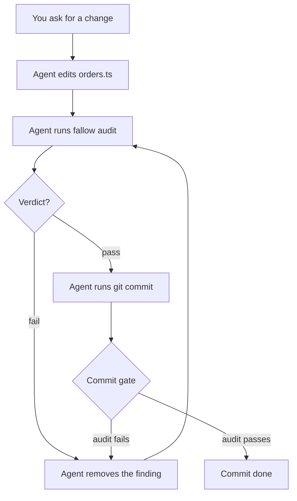

A coding agent writes code fast, and it often leaves an export or a helper that nothing uses, or a copy of code that the project already has. Nobody sees it until the review of the pull request. Here, you give the agent a check that finds what it added, before it commits. After one command, the agent runs `fallow audit` on its own change and fixes the findings.

A **coding agent** is a program that edits the code of your project on request, for example Claude Code, Codex or Cursor. The output of fallow calls it a harness. In Claude Code and Codex, the setup also adds the commit gate: a hook that runs `fallow audit` before each `git commit` and `git push` of the agent, and stops the command when the audit fails. Cursor has no commit gate, so there the agent runs the check because its instructions tell it to.

## Before you start

- You use Claude Code, Codex or Cursor in the project.
- Fallow is a development dependency of the project: `npm install -D fallow`. The agent then uses the same fallow version as your team. [Installation](/installation) shows the other package managers.
- You know the [changed-code check](/concepts/changed-code) (`fallow audit`) and its verdict. [Check each pull request](/start/first-ci) shows it in CI.

## Preview the setup

Run the install with `--dry-run` first. This changes no files:

```bash
npx fallow agent install --dry-run
```

```text
fallow agent install (dry run)
  harnesses: claude, codex, cursor (detected)

Shared with your team (commit these):
  AGENTS.md                                 would write    guide             scaffold with the fallow task map
  CLAUDE.md                                 would write    guide (claude)    create with an @AGENTS.md import
  .agents/skills/fallow                     would write    skill             pointer to node_modules/fallow/skills/fallow; read by Codex, Cursor
  .claude/skills/fallow                     would write    skill (claude)    pointer to node_modules/fallow/skills/fallow
  .mcp.json                                 would write    mcp (claude)
  .codex/config.toml                        would write    mcp (codex)       applies once Codex trusts this project; the codex mcp add next action works immediately
  .cursor/mcp.json                          would write    mcp (cursor)
  .claude/settings.json                     would write    hooks (claude)    PreToolUse gate handler
  .claude/hooks/fallow-gate.sh              would write    hooks (claude)    gate script
  .codex/hooks.json                         would write    hooks (codex)     PreToolUse gate handler; Codex runs it after you trust it in /hooks
  .codex/hooks/fallow-gate.sh               would write    hooks (codex)     gate script
  -                                         skipped        hooks (cursor)    unsupported_harness: Cursor's beforeShellExecution hook uses a different contract; Cursor still reads AGENTS.md

Local to you:
  .claude/settings.local.json               skipped        mcp (claude)      approval_not_requested: pass --approve to pre-approve the project MCP server for yourself
```

Fallow found all three agents from their folders in the project and in your home folder, and from the session that runs the command. The `skipped` line for Cursor is the missing commit gate. The last line is about the MCP server: Claude Code asks you to approve it when it starts, and `npx fallow agent install --approve` gives that approval for you in advance.

## Install

The dry run wrote nothing. Run the same command without `--dry-run` to write the files:

```bash
npx fallow agent install
```

For each agent that it found, the command writes four parts:

| Step | What the agent gets |
|:--|:--|
| `guide` | `AGENTS.md` with a task map: the fallow command to run before each kind of change. Claude Code also gets a `CLAUDE.md` that imports it. |
| `skill` | The `fallow` and `fallow-setup` [skills](/integrations/agent-skills): instruction files that tell the agent which command and which options to use. |
| `mcp` | The [MCP server](/integrations/mcp) of fallow, registered in the config of the agent. The agent can then call fallow as typed tools. |
| `hooks` | The commit gate, in Claude Code and Codex. Codex runs it after you trust it in `/hooks`. |

The task map is the part that the agent reads before it acts. These are four of its rows in `AGENTS.md`:

```markdown
| When the agent is about to... | Run |
|---|---|
| delete an "unused" export or file | `fallow dead-code --trace <file>:<export>` |
| delete an "unused" dependency | `fallow dead-code --trace-dependency <name>` |
| commit or open a PR | `fallow audit --base <ref>` |
| consolidate duplication | `fallow dupes --trace dup:<fingerprint>` |
```

Commit the files under "Shared with your team", so that each team member gets the same setup. To skip a part, add `--without` with the step name, for example `--without hooks`. `npx fallow agent uninstall` removes what fallow wrote, and in a file that you changed, it removes only the fallow block.

## Watch the loop

Ask the agent for a change. In this example, the agent adds two functions to `src/services/orders.ts`, and the app uses only one of them. The diagram shows what happens next: the agent checks its change, fixes what it added, and commits only when the audit passes.



Before it commits, the agent runs the check that `AGENTS.md` names, `npx fallow audit --format json --quiet`. The JSON output has a `verdict` field, and each finding has an `introduced` field, so the agent can find the new unused export. If the agent tries to commit first, the commit gate blocks the commit and sends this message to the agent:

```text
fallow-gate: verdict fail, 1 finding(s) caused the block:
  unused-export src/services/orders.ts:22 describeOrder
```

The agent removes `describeOrder`, runs the audit again, and gets the verdict `pass`. Then the commit goes through. Old findings in the same file, such as `cancelOrder`, do not block the commit.

## Rules for agents that call the CLI

A skill or a script that runs fallow parses the JSON output, previews each fix, and reads the exit code. [Rules for an agent that runs fallow](/integrations/agents#rules) lists each rule.

## What you learned

- `fallow agent install` writes the task map, the skills, the MCP server and the commit gate in one pass.
- The agent runs `fallow audit` on its own change and fixes what it added.
- In Claude Code and Codex, the commit gate blocks a commit when the audit fails.

## Next

- Next: [Entry points and reachability](/concepts/entry-points). It explains how fallow decides that code is used, so that you can judge each finding.
- [Verify a change](/integrations/agents#verify): get evidence that a task of the agent is done, from the tests, the audit and the diff-risk rules.
- [Coding agents](/integrations/agents): compare the CLI, the skills, MCP and the commit gate.
